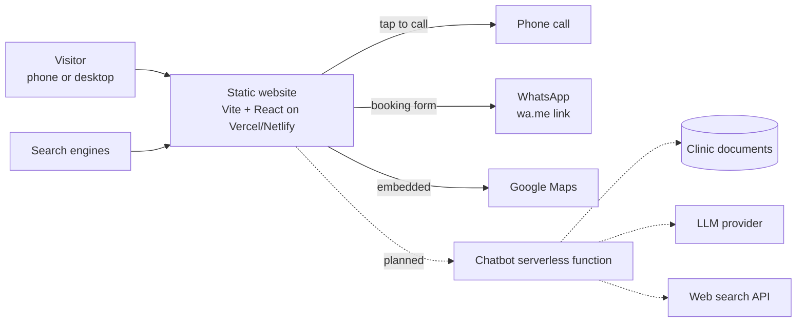
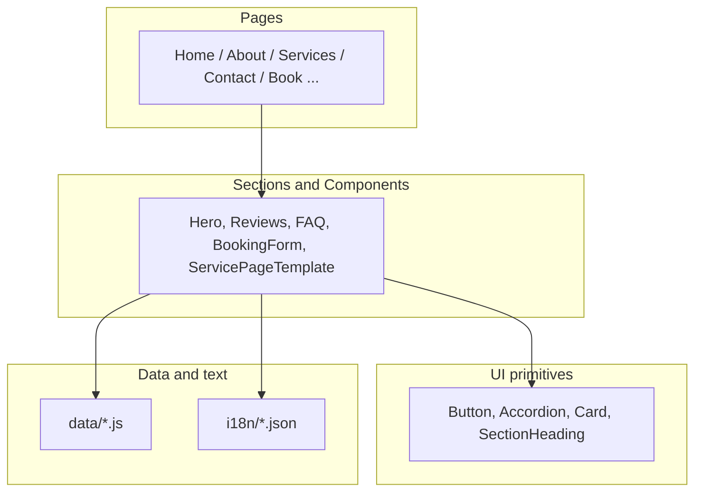
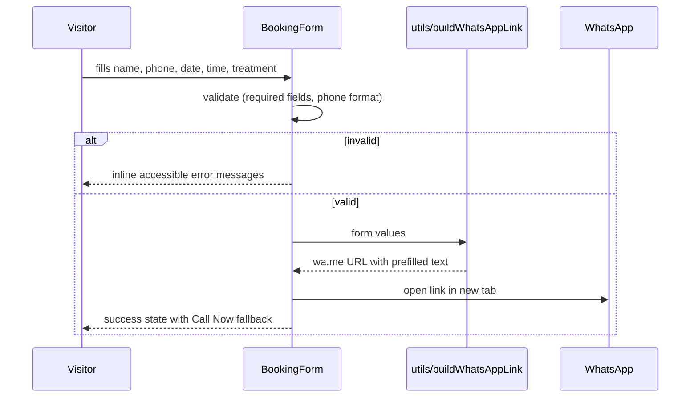
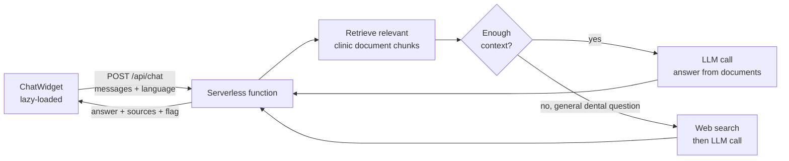
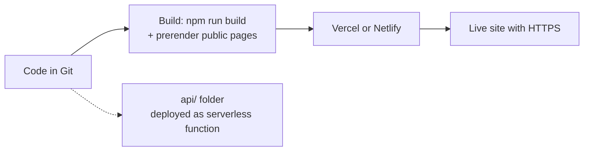

# architecture.md: Metro Dental BD

This document describes how the website is structured and why. It works together with:

- `PROJECT  .md`: what to build
- `AGENTS.md`: how an AI agent should work in this repo
- `architecture.md` (this file): how the pieces fit together

---

## 1. Overview

Metro Dental BD is a **static single-page application (SPA)** built with Vite and React. It has no backend for the core site. Content is stored in data files, text is stored in translation files, and bookings are handed off to WhatsApp.

An optional **AI chatbot** is planned. It is the only part that needs a server-side function, and it is isolated so the rest of the site never depends on it.

**Design principles**
1. **Conversion first:** every page leads the visitor to call or book.
2. **Content separate from code:** the clinic owner can change text, services, FAQs, and reviews without touching components.
3. **Mobile first:** most visitors use phones.
4. **Simple and cheap to host:** static hosting, no database.
5. **Optional complexity:** the chatbot can be added, removed, or replaced without breaking the site.

---

## 2. System Context



Solid lines are in scope for launch. Dotted lines are the planned chatbot.

---

## 3. Tech Stack and Reasons

| Layer | Choice | Why |
|---|---|---|
| Build tool | Vite | Fast dev server, simple config, small output |
| UI | React | Component reuse (one service template, many pages) |
| Routing | React Router | Multi-page feel with client-side navigation |
| Styling | Tailwind CSS | Fast, consistent, mobile-first utilities and theme tokens |
| Icons | lucide-react | Small, tree-shakable |
| SEO | react-helmet-async | Per-page title and meta tags |
| i18n | JSON files + small helper | Bangla/English with no heavy library |
| Hosting | Vercel or Netlify | Free tier, HTTPS, easy deploys from Git |
| Booking | WhatsApp link | No backend, matches how patients already contact clinics |

**SEO note:** a client-rendered SPA is weaker for search engines than server-rendered pages. For a local clinic, local search ranking matters. Options, in order of effort:

1. Start with Vite + React and pre-render the public pages at build time (for example with `vite-plugin-ssg` or a prerender plugin).
2. If SEO becomes the top priority, migrate to Next.js. The component and data structure below carries over directly.

---

## 4. Folder Structure

```
metro-dental-bd/
├─ public/
│  ├─ images/               # photos (clinic, Dr. Mustak, equipment)
│  ├─ favicon.ico
│  ├─ sitemap.xml
│  └─ robots.txt
├─ src/
│  ├─ main.jsx              # app entry
│  ├─ App.jsx               # router and layout
│  ├─ components/
│  │  ├─ layout/            # Header, Footer, MobileMenu, FloatingCTA
│  │  ├─ ui/                # Button, SectionHeading, Accordion, Card
│  │  ├─ sections/          # Hero, TrustStrip, DoctorIntro, Reviews, FAQ, Location, CTABanner
│  │  ├─ services/          # ServiceCard, ServicePageTemplate
│  │  ├─ booking/           # BookingForm
│  │  └─ chatbot/           # planned: ChatWidget, ChatWindow, useChat
│  ├─ pages/                # Home, About, Services, ServiceDetail, Problems, NewPatients, Contact, Book, NotFound
│  ├─ data/
│  │  ├─ clinic.js          # name, address, phone, hours, map link, social links
│  │  ├─ services.js        # all service content
│  │  ├─ problems.js
│  │  ├─ faqs.js
│  │  └─ reviews.js
│  ├─ i18n/
│  │  ├─ en.json
│  │  ├─ bn.json
│  │  └─ LanguageContext.jsx
│  ├─ hooks/                # useScrollReveal, useMediaQuery, etc.
│  ├─ utils/                # buildWhatsAppLink, validatePhone, seo helpers
│  └─ styles/               # index.css (Tailwind layers)
├─ api/                     # planned: serverless chatbot function
├─ tailwind.config.js
├─ vite.config.js
├─ specs.md
├─ agent.md
└─ architecture.md
```

---

## 5. Application Architecture

### 5.1 Layers



Rules that keep this clean:
- **Pages** only compose sections. They contain no business logic.
- **Sections** read from `data/` and `i18n/`. They do not hardcode clinic facts or text.
- **UI primitives** know nothing about the clinic. They could be reused in any project.
- Dependencies point downward only. A UI primitive never imports a section.

### 5.2 Routing

| Route | Page component | Notes |
|---|---|---|
| `/` | `Home` | Full conversion layout |
| `/about` | `About` | Clinic story and Dr. Mustak |
| `/services` | `Services` | Overview grid |
| `/services/:slug` | `ServiceDetail` | One template, data from `services.js` |
| `/problems` | `Problems` | Patients search by problem, not treatment |
| `/new-patients` | `NewPatients` | What to expect and bring |
| `/contact` | `Contact` | Address, hours, map, form |
| `/book` | `Book` | Booking form |
| `*` | `NotFound` | Links back to Home and Book |

`ServiceDetail` reads the `:slug`, looks up the entry in `services.js`, and renders `ServicePageTemplate`. An unknown slug redirects to `NotFound`. Adding a new service means adding one data entry, not a new page file.

### 5.3 Layout

`App.jsx` wraps all routes in one layout:

```
<LanguageProvider>
  <HelmetProvider>
    <Header />        sticky, with phone and Book button
    <main>
      <Routes />
    </main>
    <Footer />
    <FloatingCTA />   mobile call + WhatsApp buttons
    <ChatWidget />    planned, lazy-loaded
  </HelmetProvider>
</LanguageProvider>
```

---

## 6. Data Architecture

All editable content is plain JavaScript objects. There is no database.

**clinic.js** (single source of truth)
```js
export const clinic = {
  name: "Metro Dental BD",
  dentist: "Dr. Mustak",
  phone: "01716374977",
  whatsapp: "8801716374977",        // international format, no plus sign
  address: "59 Kazi Alauddin Rd, Bangshal, Dhaka 1100",
  landmarks: "Beside Beauty Lacchi and Alom Khan Tea",
  hours: [/* TODO: add opening hours */],
  mapEmbedUrl: "",                   // TODO
  social: { facebook: "", instagram: "" },
};
```

**services.js** (one entry per service)
```js
{
  slug: "dental-implant",
  featured: true,
  icon: "...",
  image: "/images/implant.jpg",
  // user-facing text keys resolve through i18n:
  titleKey: "services.implant.title",
  introKey: "services.implant.intro",
  forWhom: ["..."],
  steps: ["..."],
  faqs: [{ qKey: "...", aKey: "..." }],
}
```

**Bilingual text:** components call `t("key")`. The helper looks up the key in `en.json` or `bn.json` based on the selected language and falls back to English if a Bangla key is missing. The chosen language is saved in `localStorage` and also sets the `lang` attribute on `<html>`.

---

## 7. Key Flows

### 7.1 Booking flow



The booking is a **message**, not a confirmed appointment. The success message should say the clinic will confirm by reply. If the clinic later wants real scheduling, replace `buildWhatsAppLink` with a call to a booking API. The form component stays the same.

### 7.2 Language toggle

Toggle click updates `LanguageContext`, which stores the language in `localStorage` and updates the `lang` attribute. All components re-render with the new strings. No page reload.

### 7.3 SEO per page

Each page renders a `<SEO title description />` helper that sets the title, meta description, Open Graph tags, and canonical URL through react-helmet-async. The Home and Contact pages also add the `Dentist` JSON-LD block built from `clinic.js`.

---

## 8. Planned Chatbot Architecture

The chatbot is optional and isolated. The site must work fully if it is disabled.



**Design decisions**
- **Server-side only for model calls.** The function holds the API keys. The browser never sees them.
- **Documents first.** Clinic documents (services, prices, hours, FAQs) are the primary source. Web search is a fallback for general dental information, and those answers are labeled as general information.
- **Small document set.** The clinic's documents are short, so start with simple keyword or embedding search over a handful of text chunks stored in the repo (`api/knowledge/`). A vector database is not needed at this size.
- **Safety rules in the system prompt.** No diagnosis, no prescriptions, no personal medical advice. For pain, symptoms, or emergencies, tell the visitor to call the clinic.
- **Always show contact options.** Call and WhatsApp buttons appear inside the chat window.
- **Rate limiting and abuse control.** Limit requests per IP and cap message length and conversation length to control cost.
- **Languages.** The function receives the current language and answers in English or Bangla.
- **Open decision:** which model provider and host to use. Decide this before building, because it affects cost, Bangla quality, and setup.

---

## 9. Cross-Cutting Concerns

### 9.1 Performance
- Route-level code splitting with `React.lazy`.
- The chatbot bundle loads only after the page is idle or the visitor clicks the widget.
- Images compressed (WebP), explicit width and height to avoid layout shift, lazy loading below the fold.
- Hero video (if used) is muted, compressed, short, and has a poster image. On slow connections or mobile data, show the poster only.
- Self-host fonts or use `font-display: swap`, and limit weights.
- Target: Lighthouse performance above 90 on mobile.

### 9.2 Accessibility
- Semantic HTML and one `h1` per page.
- Visible focus states and full keyboard navigation (menu, accordion, carousel, form).
- Color contrast meets WCAG AA.
- Labels, error messages, and `aria-live` for form feedback.
- Animations respect `prefers-reduced-motion`.

### 9.3 SEO and local search
- Unique title and meta description per page.
- `Dentist` / `LocalBusiness` JSON-LD with address, phone, hours.
- `sitemap.xml` and `robots.txt` updated when routes change.
- Name, address, and phone must match the Google Business Profile exactly.
- Problem pages and service pages target how patients actually search.

### 9.4 Security and privacy
- No secrets in the repo or the front end.
- The booking form sends no data to any server of ours. Data goes only to WhatsApp when the visitor chooses to send.
- Chatbot: do not log personal or medical details. If conversations are stored for improvement, tell visitors and keep retention short.
- Use HTTPS only. Add basic security headers through the host configuration.

### 9.5 Analytics
Track only what supports the goal: clicks on Call, WhatsApp, and Book buttons, and booking form submissions. Use a privacy-friendly tool (for example Plausible or Google Analytics with consent) and send events through one small wrapper so the provider can change later.

---

## 10. Build and Deployment



1. Push to a Git repository.
2. The host builds on every push. Pull requests get a preview URL.
3. `main` deploys to production.
4. Connect a custom domain and enable HTTPS.
5. Add environment variables (only needed for the chatbot) in the host dashboard.

---

## 11. Extension Points

| Future need | Where to change | Impact |
|---|---|---|
| New service | Add an entry to `data/services.js` and i18n keys | No new component |
| New language | Add a JSON file and register it in `LanguageContext` | No component changes |
| Real appointment scheduling | Replace `utils/buildWhatsAppLink` call with a booking API | Form UI unchanged |
| Blog | Add `pages/Blog` and a `data/posts` source (or a headless CMS) | New route only |
| CMS for the clinic staff | Replace `data/*.js` reads with CMS fetches | Components unchanged if the data shape stays the same |
| Move to Next.js | Reuse components, data, and i18n files | Routing and head management change |
| Chatbot provider change | Edit only the serverless function | Widget unchanged |

---

## 12. Known Risks and Decisions

| Item | Risk or open question | Suggested handling |
|---|---|---|
| SPA and SEO | Client rendering can hurt local search | Pre-render public pages, or move to Next.js |
| Placeholder content | Fake reviews or missing hours reaching production | Mark all placeholders `[TODO]`, review the checklist in `agent.md` before launch |
| Bangla quality | Machine-written Bangla can read unnaturally | Have a native speaker review `bn.json` |
| WhatsApp-only booking | No confirmation or calendar | State clearly that the clinic will confirm. Revisit if volume grows |
| Chatbot cost and misuse | Spam or long conversations raise cost | Rate limits, message caps, and a monthly spending cap |
| Chatbot medical advice | Visitors may treat answers as diagnosis | Strict system prompt, visible disclaimer, call button always shown |
| Open decisions | Chatbot model provider and hosting, opening hours, map embed link, real photos | Owner to decide before the related work starts |
